# PhotoBlogProject 📸

**Django PhotoBlog REST API + Android PhotoViewer**

A mobile/web service project developed for **2026 Fall Semester – Mobile/Web Service Project (모바일/웹서비스 프로젝트), 공통평가 01**. The system connects a Django-based photo blog and REST API to a native Android photo viewer, allowing users to browse, synchronize, and upload image posts.

## Project overview

The project demonstrates end-to-end communication between a Python web server and an Android client. Photo posts contain a title, description, image, and publication information. The Android app retrieves posts from the REST API and displays them as image cards. It also supports creating new posts by selecting a photo from the device.

**Live deployment:** [Django PhotoBlog on PythonAnywhere](https://amizhae.pythonanywhere.com/)  
**REST API:** [Photo posts endpoint](https://amizhae.pythonanywhere.com/api_root/Post/)  

## Technology stack

| Component | Technology |
| --- | --- |
| Web backend | Python, Django |
| REST API | Django REST Framework (DRF) |
| Android application | Kotlin, Android SDK, XML layouts |
| HTTP communication | REST API, JSON, multipart/form-data |
| Data storage | Django database and uploaded media files |
| Testing | Python automated tests, Coverage.py |
| Request inspection | Python socket server |
| Cloud hosting | PythonAnywhere |
| Development tools | VS Code, Android Studio, Git, GitHub |

## System architecture

```text
                  ┌───────────────────────────┐
                  │ Android PhotoViewer       │
                  │ Kotlin / Android SDK      │
                  └─────────────┬─────────────┘
                                │
                   GET / POST (HTTP + JSON)
                                │
                  ┌─────────────▼─────────────┐
                  │ Django REST Framework     │
                  │ /api_root/Post/           │
                  └─────────────┬─────────────┘
                                │
                  ┌─────────────▼─────────────┐
                  │ Django PhotoBlog          │
                  │ Posts, database, images   │
                  └───────────────────────────┘
                                │
                     Hosted on PythonAnywhere
```

## Main features

### Django PhotoBlog and REST API

- Create and publish photo blog posts with a title, description, and image.
- View individual blog posts through the Django web interface.
- Retrieve photo post data in JSON format using the REST API.
- Accept new photo posts through HTTP POST requests.
- Serve uploaded images to the Android client.

### Android PhotoViewer

- **Sync Photos:** Download photo post data from the Django REST API.
- **Upload Photo:** Enter a title and description, choose an image, and submit a new post.
- **Photo feed:** Display image posts and their titles in a scrollable list.
- **Cloud integration:** Connect to the deployed PythonAnywhere server.

## Five additional Android convenience features

The following five features were implemented for **Requirement 14** of the project report.

| # | Feature | Description |
| --- | --- | --- |
| 1 | **Search Photos** | Filter posts by title as keywords are entered in the search bar. |
| 2 | **Pull to Refresh** | Swipe down on the photo list to request the latest posts from the server. |
| 3 | **Photo Sorting** | Select **Newest first** or **Oldest first** from the sorting dialog. |
| 4 | **Enlarged Photo Viewer** | Tap a photo to see a larger image, title, and full scrollable description. |
| 5 | **Favorite Photos** | Tap the heart on a photo to save it as a favorite; use the floating heart button to display favorites only. Favorite selections are stored locally using Android `SharedPreferences`. |

### Search photos

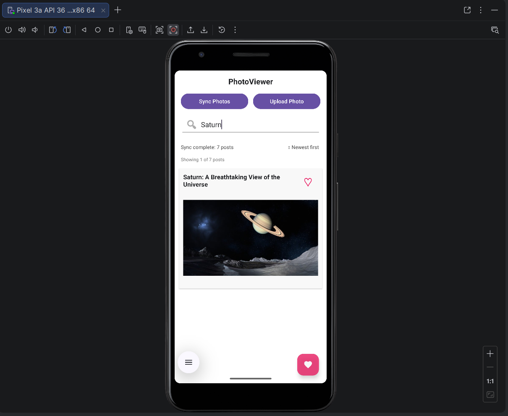

### Pull to refresh

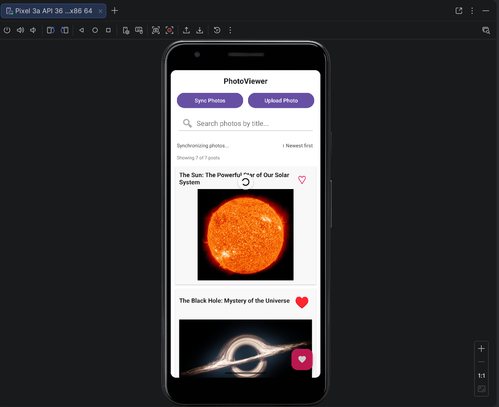

### Sort photos

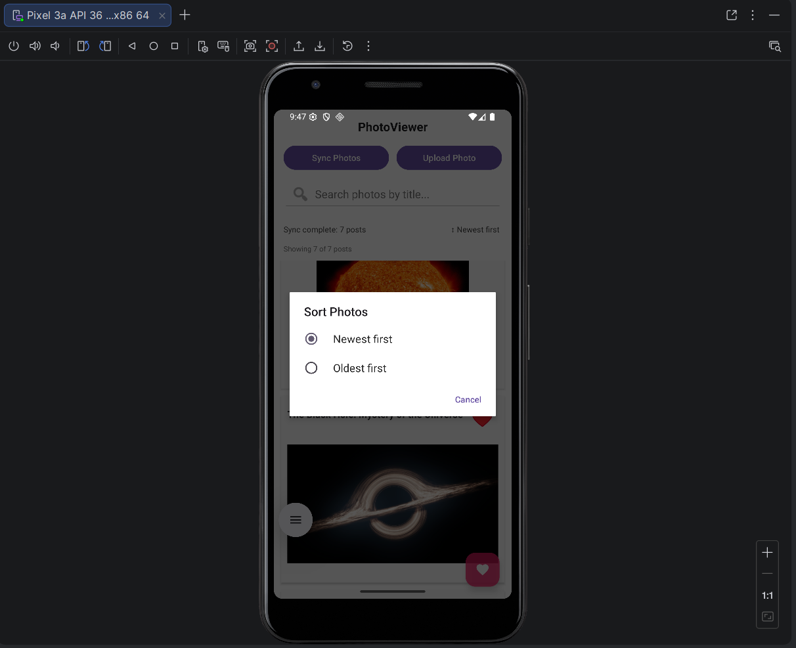

### Enlarged photo viewer

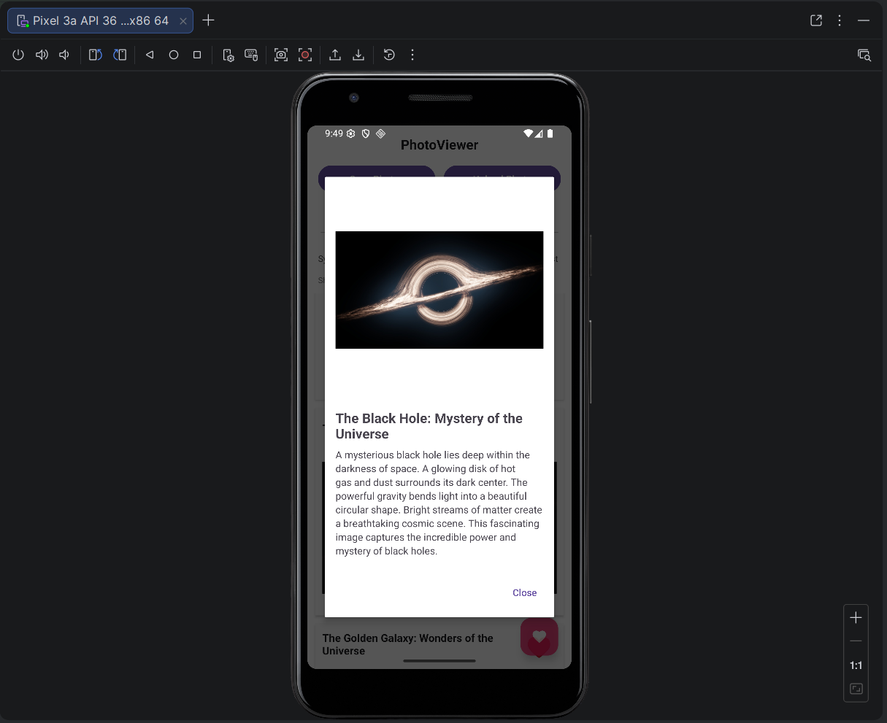

### Favorite photos

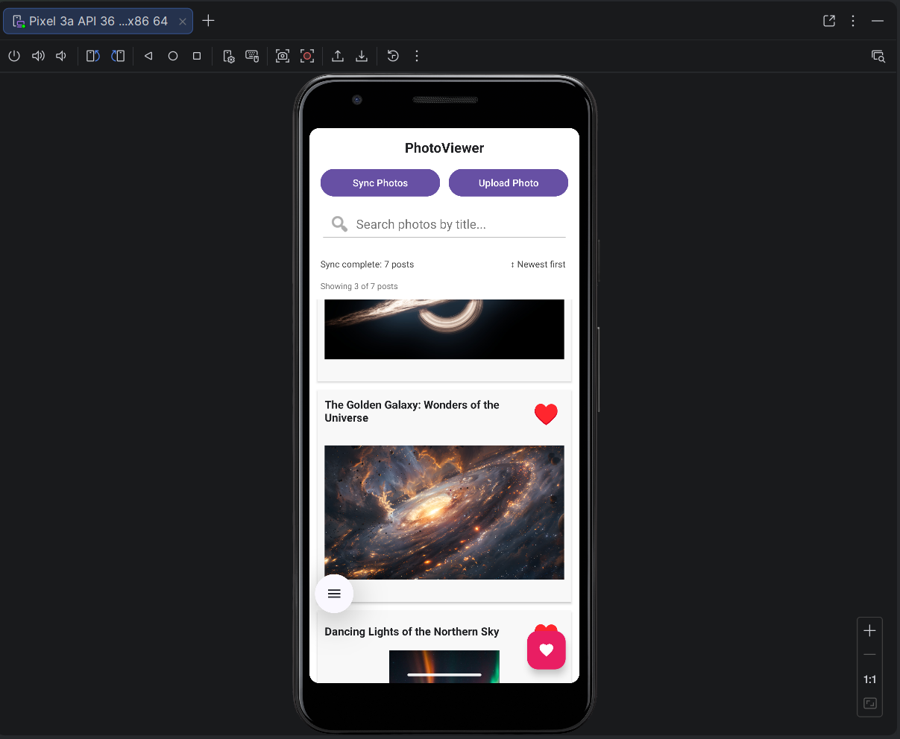

## Screenshots and demonstrations

### 1. Django PhotoBlog

A published post can be viewed through the Django web interface.

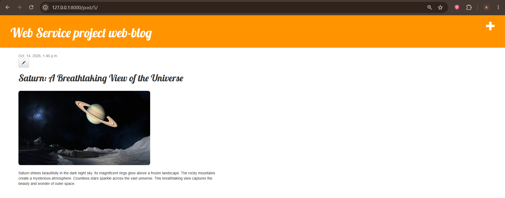

### 2. Django REST API

The DRF interface exposes the photo posts endpoint, including titles, descriptions, publication dates, and image URLs.

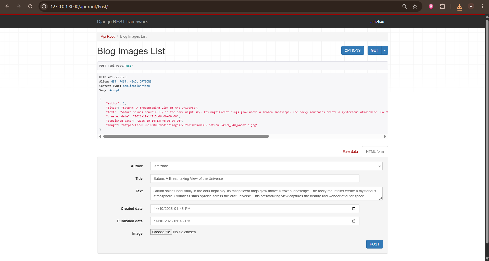

### 3. API validation

API responses were checked using a terminal and JSON viewing tools.

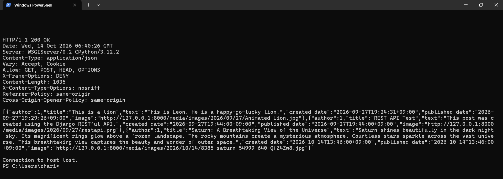

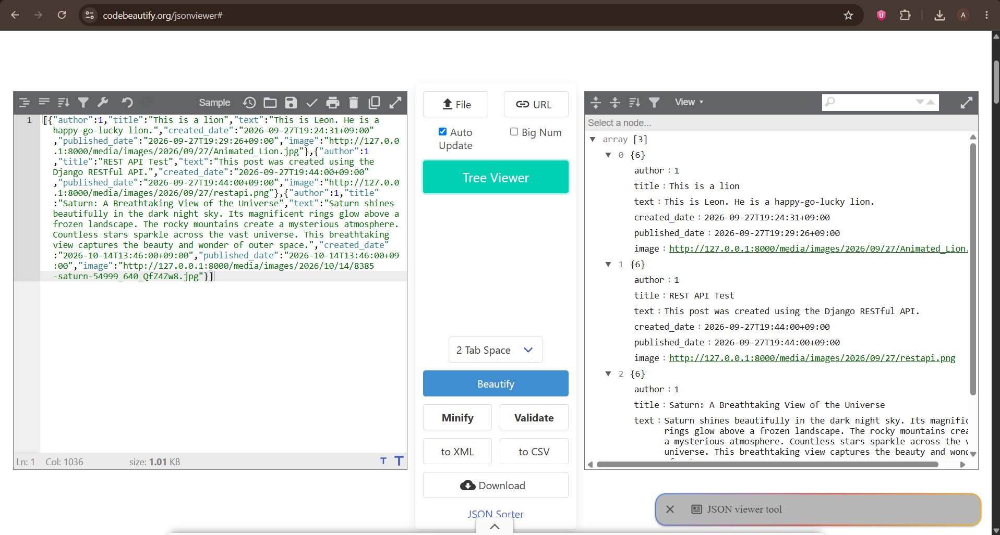

### 4. Automated testing and code coverage

Python tests were executed and an HTML coverage report was generated. The captured report shows **100% coverage of the 193 measured statements** in that test run.

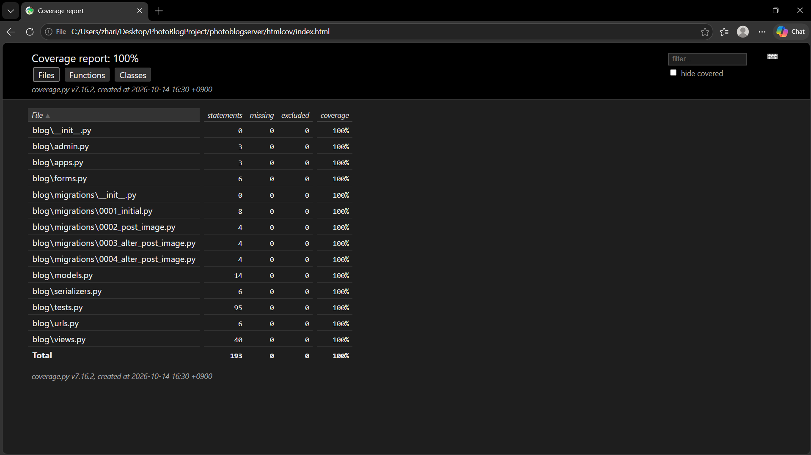

### 5. Socket server request inspection

A Python socket server captured an Android HTTP request and saved the request data to a `.bin` file for inspection.

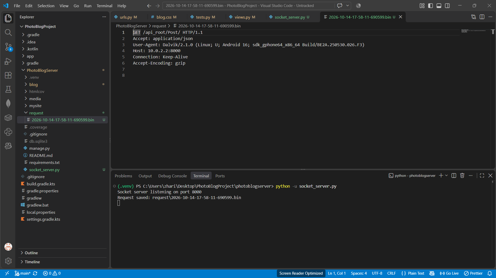

### 6. Android client synchronization

The Android app retrieves posts from the Django server and renders their images.

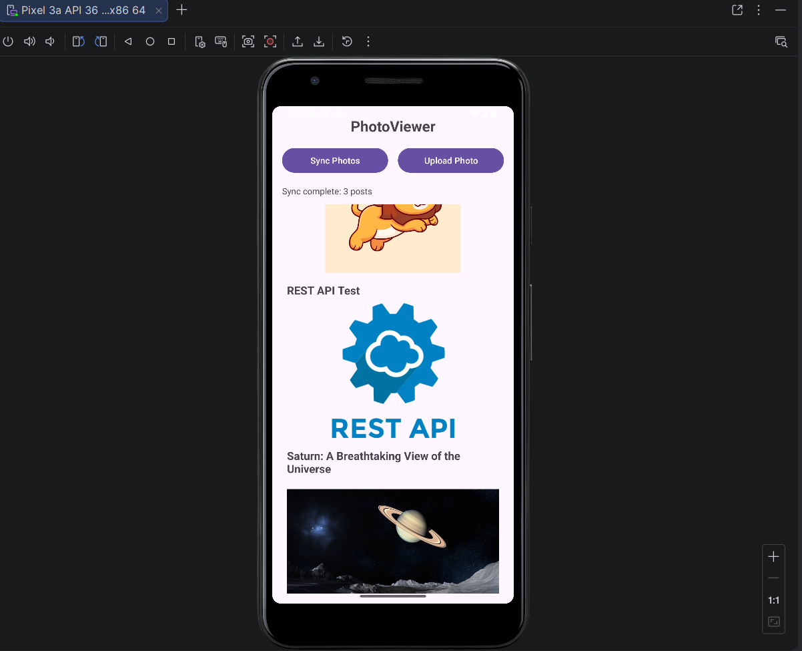

### 7. Uploading from Android

Users can enter post information and select an image using the upload dialog.

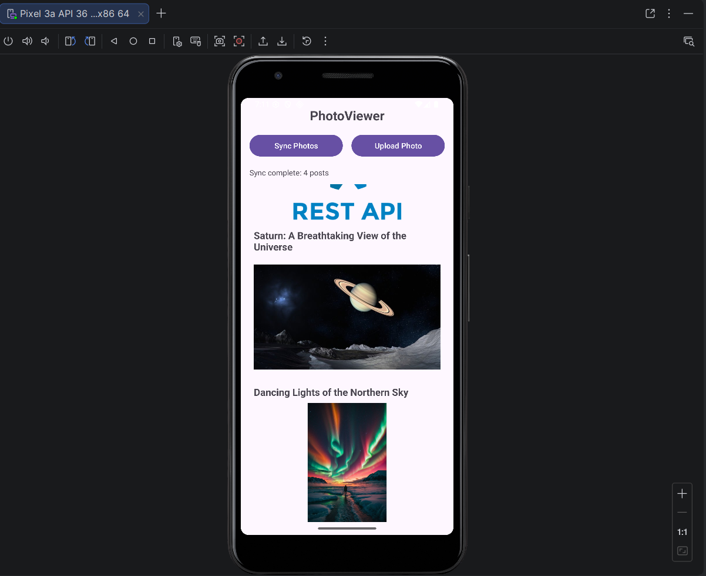

### 8. PythonAnywhere cloud deployment

The Django application is deployed on PythonAnywhere, and the Android client can synchronize with the cloud-hosted API.

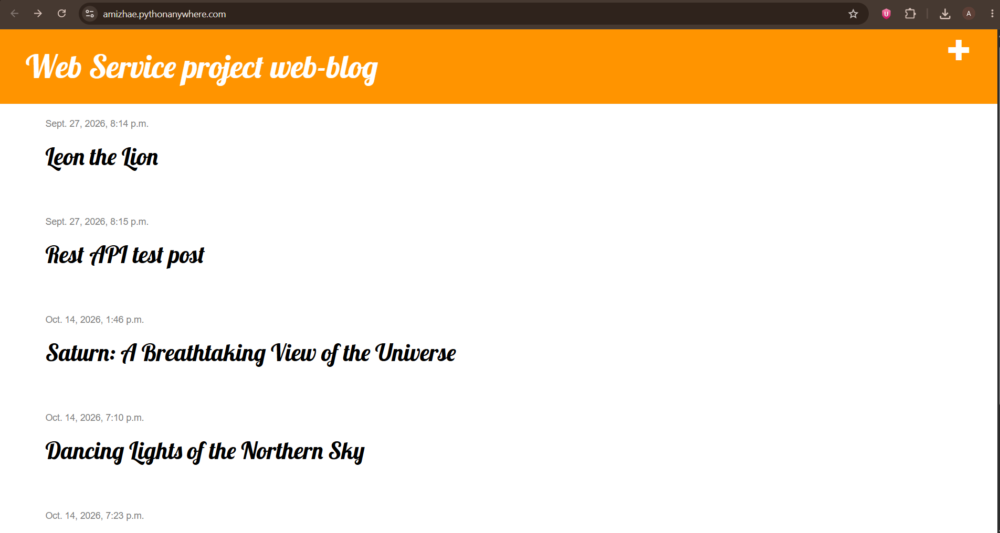

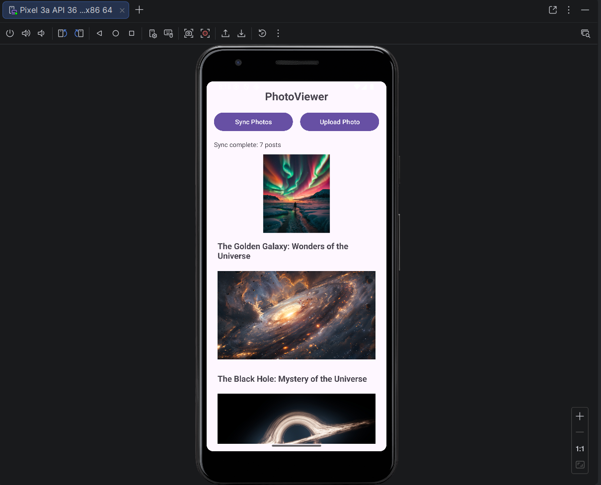

## Repository structure

```text
PhotoBlogProject/
├── PhotoBlogServer/          # Django backend, REST API and testing
├── PhotoViewerApp/           # Android client application
├── docs/
│   └── screenshots/          # Images displayed in this README
├── README.md
└── ...                      # Project and assessment files
```

> The Android project directory is named `PhotoViewerApp` in the repository screenshots. If your local folder has a different name, use that folder when opening the project in Android Studio.

## Running the project locally

### Django backend

1. Clone the repository and open the Django server directory.
2. Create and activate a Python virtual environment.
3. Install the server dependencies.
4. Apply database migrations and start the Django development server.

```powershell
git clone https://github.com/AmiZhae/PhotoBlogProject.git
cd PhotoBlogProject\PhotoBlogServer
python -m venv .venv
.\.venv\Scripts\Activate.ps1
pip install -r requirements.txt
python manage.py migrate
python manage.py runserver
```

Local web app: `http://127.0.0.1:8000/`  
Local API: `http://127.0.0.1:8000/api_root/Post/`

### Android client

1. Open `PhotoViewerApp` in Android Studio.
2. Allow Gradle to sync and start an emulator or connect an Android device.
3. Check the server URL configured in the Android client.
4. Run the app and select **Sync Photos**.
5. Use **Upload Photo** to create a new photo post.

**Networking note:** The Android emulator accesses a Django server running on the host computer using `10.0.2.2` instead of `127.0.0.1`. The deployed server can be accessed using its PythonAnywhere URL. Make sure the Android app is configured for the intended server and that the required network permissions are enabled.

## API overview

| Method | Endpoint | Purpose |
| --- | --- | --- |
| `GET` | `/api_root/Post/` | Retrieve photo posts |
| `POST` | `/api_root/Post/` | Create a photo post |

Example response fields shown in the project report:

```json
{
  "author": 1,
  "title": "Saturn: A Breathtaking View of the Universe",
  "text": "Saturn shines beautifully in the dark night sky.",
  "created_date": "2026-10-14T13:46:00+09:00",
  "published_date": "2026-10-14T13:46:00+09:00",
  "image": "http://127.0.0.1:8000/media/images/2026/10/14/example.jpg"
}
```

*This is an illustrative JSON example based on the fields demonstrated in the report; the actual response may contain different post data.*

## Author

**Ahmad Amirul Zharif**  
GitHub: [@AmiZhae](https://github.com/AmiZhae)

## Academic context

Developed for **2026년 2학기 모바일/웹서비스 프로젝트 – 공통평가 01** (2026 Fall Semester Mobile/Web Service Project – Common Assessment 01).
